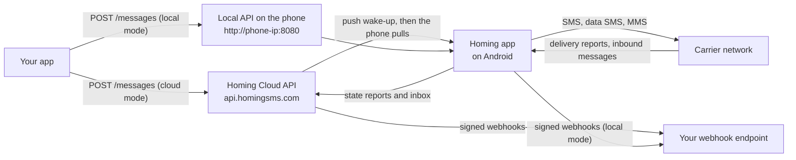

# Homing

Homing turns Android phones into an SMS gateway you control.

## What it does

Install the Homing app on an Android phone with a SIM card and your software can send SMS, data SMS and MMS through it with a simple HTTP API. Delivery reports and received messages come back to you as signed webhooks.

You can run one phone on its own, with the API served by the phone over your local network. Or you can pair one or many phones with Homing Cloud, call `api.homingsms.com`, and manage the whole fleet from the Homing Cloud console.

Both modes use the same request and response shapes, the same API key format and the same webhook signatures, so code written against one works with the other.

## Quickstart in 60 seconds (local mode)

You need an Android phone running Android 7.0 or newer with an active SIM, on the same network as the computer you send from.

1. **Install the APK.** Download the signed release APK and its SHA-256 checksum from the Android repository's releases, or build it yourself (see [Development](#development)). Install it with `adb install -r homing.apk` or by opening the file on the phone.
2. **Finish onboarding.** The app walks you through the SMS, phone and notification permissions one at a time, the battery optimization exemption, the Android 13+ restricted settings step when the install needs it, and the choice of Local or Cloud mode. Pick Local.
3. **Turn on the local server.** The server listens on port `8080` by default. The app shows the phone's address, for example `http://<phone-ip>:8080/api/v1`.
4. **Create a local API key.** In the app's local server settings, create a key with the `messages:send` and `messages:read` scopes. Copy it now: the phone stores only a hash, so the full key is shown once.
5. **Send an SMS.**

```bash
export HOMING=http://<phone-ip>:8080/api/v1
export HOMING_KEY=hk_live_...

curl -X POST "$HOMING/messages" \
  -H "Authorization: Bearer $HOMING_KEY" \
  -H "Content-Type: application/json" \
  -d '{"type":"sms","to":"+15555215554","text":"Hello from Homing","idempotencyKey":"hello-1"}'
```

The phone answers `202 Accepted` with the new message. Note its `id`:

```json
{
  "id": "msg_V1StGXR8Z5jdHi6BmyT",
  "type": "sms",
  "to": "+15555215554",
  "text": "Hello from Homing",
  "state": "pending",
  "priority": "normal",
  "idempotencyKey": "hello-1",
  "deliveryReport": true,
  "createdAt": "2026-11-12T10:15:30.000Z",
  "events": [
    { "state": "pending", "at": "2026-11-12T10:15:30.000Z", "deviceId": "dev_...", "simSlot": null, "error": null }
  ]
}
```

(Trimmed. Every message carries the full set of fields listed in the OpenAPI spec, with `null` where a field does not apply.)

6. **Check its status.**

```bash
curl "$HOMING/messages/msg_V1StGXR8Z5jdHi6BmyT" \
  -H "Authorization: Bearer $HOMING_KEY"
```

`state` moves from `pending` to `queued`, `sending`, `sent` and, when the carrier confirms, `delivered`. The `events` array is the full timeline, with the carrier error on a `failed` step.

The local server also answers `GET /api/v1/health` without a key and serves its own OpenAPI document at `/api/v1/docs/openapi.json`.

## Cloud quickstart

1. **Sign up** in the Homing Cloud console and create your account.
2. **Pair the phone.** In the console, add a device to get a pairing code (for example `K7PM-4XQ2`) and a QR code. In the app, choose Cloud mode and enter the code, or scan the QR code with the phone, which opens its `homing://pair` link in Homing. A code works once and expires after 10 minutes. The phone stores its device token encrypted with an Android Keystore key.
3. **Create an API key.** In the console, create an `hk_live_` key with the scopes your app needs. The secret is shown once.
4. **Send through Homing Cloud.**

```bash
curl -X POST https://api.homingsms.com/api/v1/messages \
  -H "Authorization: Bearer hk_live_..." \
  -H "Content-Type: application/json" \
  -d '{"type":"sms","to":"+15555215554","text":"Hello from Homing","idempotencyKey":"order-4471-shipped"}'
```

Homing Cloud picks an online phone and SIM with your account's routing strategy (`round_robin` or `least_used`), wakes the phone and tracks the message through to `delivered`. Pass `deviceId`, and optionally `simSlot`, to pin a message to one phone and SIM.

## How it works



In cloud mode the phone never receives message content by push. Homing Cloud routes a message to a device and sends a Firebase Cloud Messaging wake-up that only says there is work. The phone then pulls up to 50 messages. Each pull leases its messages with `FOR UPDATE SKIP LOCKED` in one transaction, so two phones can never take the same message. The phone confirms a lease by reporting `queued`. A lease that is not confirmed in time (120 seconds by default) puts the message back in the queue, up to 3 attempts. A late report from a slow phone that did send the message is still accepted, so it is not sent twice.

Push is optional. Without Firebase the phone still sends a heartbeat every 60 seconds by default, pulls when a heartbeat reports pending messages, and pulls every `pullIntervalSeconds` as a fallback. A background job repeats the heartbeat every 15 minutes in case the foreground service was stopped.

## Local vs Cloud mode

| | Local mode | Cloud mode |
| --- | --- | --- |
| Best for | One phone, a single app on the same network, no third party in the path | Several phones, apps outside your network, a team using a console |
| API address | `http://<phone-ip>:8080/api/v1` | `https://api.homingsms.com/api/v1` |
| API keys | Created and revoked in the app | Created and revoked in the console or with `POST /api-keys` |
| Routing | The phone itself, optionally a chosen `simSlot` | Across all online phones with `round_robin` or `least_used`, per-device and per-SIM daily limits |
| Message states | `pending` then `queued` and onward; `leased` never appears | The full set, including `leased` |
| Webhooks | Sent by the phone | Sent by Homing Cloud, including device presence events |
| Needs | The caller can reach the phone | The phone has internet access |

You can run both at once on the same phone.

## API overview

The public API lives under `/api/v1`. Homing Cloud serves all of it; the phone in local mode mirrors the messages, inbox, webhooks and health operations with the same shapes. Authenticate with `Authorization: Bearer hk_live_...`.

| Area | Operations |
| --- | --- |
| Messages | `POST /messages`, `GET /messages`, `GET /messages/{id}`, `POST /messages/{id}/cancel` |
| Inbox | `GET /inbox`, `GET /inbox/{id}`, `GET /inbox/{id}/attachments/{attachmentId}` |
| Webhooks | `GET/POST /webhooks`, `GET/PATCH/DELETE /webhooks/{id}`, `POST /webhooks/{id}/rotate-secret`, `POST /webhooks/{id}/test`, `GET /webhooks/{id}/deliveries`, `POST /webhooks/{id}/deliveries/{deliveryId}/redeliver` |
| Cloud only | Auth, account, team, API keys, devices and pairing codes, usage |
| Health | `GET /health` |

The examples below use Homing Cloud. For local mode, swap the base URL for `http://<phone-ip>:8080/api/v1`.

### Send

One message has one recipient. `type` is `sms` (`text`, up to 1600 characters, split into parts by the phone), `data` (base64 `data` up to 140 bytes, and `port`) or `mms` (`subject`, `text` and up to 10 base64 `attachments`, at most 1 MiB in total). Optional fields: `idempotencyKey`, `deviceId`, `simSlot` (needs `deviceId`), `scheduleAt`, `validUntil`, `priority` (`normal` or `otp`), `deliveryReport` (default `true`) and `metadata` (up to 20 string pairs returned on the message and its webhooks).

```bash
curl -X POST https://api.homingsms.com/api/v1/messages \
  -H "Authorization: Bearer hk_live_..." \
  -H "Content-Type: application/json" \
  -d '{"type":"sms","to":"+2348012345678","text":"Your code is 482913","priority":"otp","idempotencyKey":"otp-91f2"}'
```

`202 Accepted` with the message and its timeline in `events`, the same shape as the quickstart response. `otp` messages are leased before `normal` ones and wake the phone with a high priority push.

### Get

```bash
curl https://api.homingsms.com/api/v1/messages/msg_V1StGXR8Z5jdHi6BmyT \
  -H "Authorization: Bearer hk_live_..."
```

```json
{
  "id": "msg_V1StGXR8Z5jdHi6BmyT",
  "state": "delivered",
  "deviceId": "dev_4f90d13a42",
  "simSlot": 0,
  "attempts": 1,
  "partsCount": 1,
  "error": null,
  "sentAt": "2026-11-12T10:15:34.000Z",
  "deliveredAt": "2026-11-12T10:15:39.000Z",
  "events": [
    { "state": "pending", "at": "2026-11-12T10:15:30.000Z", "deviceId": null, "simSlot": null, "error": null },
    { "state": "leased", "at": "2026-11-12T10:15:31.000Z", "deviceId": "dev_4f90d13a42", "simSlot": 0, "error": null },
    { "state": "queued", "at": "2026-11-12T10:15:31.000Z", "deviceId": "dev_4f90d13a42", "simSlot": 0, "error": null },
    { "state": "sent", "at": "2026-11-12T10:15:34.000Z", "deviceId": "dev_4f90d13a42", "simSlot": 0, "error": null },
    { "state": "delivered", "at": "2026-11-12T10:15:39.000Z", "deviceId": "dev_4f90d13a42", "simSlot": 0, "error": null }
  ]
}
```

(Trimmed.) States are `scheduled`, `pending`, `leased`, `queued`, `sending`, `sent`, `delivered`, `failed`, `cancelled` and `expired`. `delivered`, `failed`, `cancelled` and `expired` are final. A `sent` message can still become `failed` when the carrier reports a delivery failure.

### List

```bash
curl "https://api.homingsms.com/api/v1/messages?state=failed&limit=20" \
  -H "Authorization: Bearer hk_live_..."
```

```json
{ "data": [ { "id": "msg_...", "state": "failed", "error": { "code": "no_service", "message": "..." } } ], "nextCursor": "eyJ..." }
```

Filter by `state`, `type`, `deviceId`, `simSlot` (cloud), `to`, `createdFrom` and `createdTo`. Lists are newest first. Pass `nextCursor` back as `cursor` for the next page; it is `null` on the last page. `limit` is 1 to 100.

### Cancel

```bash
curl -X POST https://api.homingsms.com/api/v1/messages/msg_V1StGXR8Z5jdHi6BmyT/cancel \
  -H "Authorization: Bearer hk_live_..."
```

```json
{ "id": "msg_V1StGXR8Z5jdHi6BmyT", "state": "cancelled", "events": [ { "state": "pending", "at": "..." }, { "state": "cancelled", "at": "..." } ] }
```

`200` with the message in `cancelled` (trimmed above). Cancel works while the message has not reached the phone's send queue: `scheduled`, `pending` or `leased` in the cloud, before `queued` on the phone. Later states return `409`.

### Inbox

```bash
curl "https://api.homingsms.com/api/v1/inbox?limit=1" \
  -H "Authorization: Bearer hk_live_..."
```

```json
{
  "data": [
    {
      "id": "inb_V1StGXR8Z5jdHi6BmyT",
      "type": "sms",
      "from": "+2348012345678",
      "to": null,
      "deviceId": "dev_4f90d13a42",
      "simSlot": 0,
      "text": "STOP",
      "data": null,
      "port": null,
      "subject": null,
      "attachments": [],
      "receivedAt": "2026-11-12T10:20:02.000Z",
      "createdAt": "2026-11-12T10:20:03.000Z"
    }
  ],
  "nextCursor": null
}
```

Filter by `type`, `deviceId`, `from`, `receivedFrom` and `receivedTo`. MMS attachments download as raw bytes from `GET /inbox/{id}/attachments/{attachmentId}`.

### Scopes

| Scope | Allows |
| --- | --- |
| `messages:send` | Send and cancel messages |
| `messages:read` | List and read messages |
| `inbox:read` | List and read received messages and attachments |
| `webhooks:manage` | Manage webhook endpoints, test events and deliveries |
| `devices:manage` | Manage devices and pairing codes in the cloud; the phone's own settings in local mode |
| `admin` | Everything, including API keys and account settings in the cloud |

A key without the needed scope gets `403`. A missing or unknown key gets `401`.

### Idempotency

Send `idempotencyKey` with every message you might retry. The same key with the same body returns the original message with `200` and `Idempotent-Replayed: true`, and nothing is sent again. The same key with a different body returns `409`. In the cloud, keys are unique per account and never expire.

### Errors

Every error has the same shape:

```json
{
  "statusCode": 400,
  "message": ["to must match /^\\+?[0-9]{3,15}$/ regular expression"],
  "error": "Bad Request",
  "timestamp": "2026-11-12T10:15:30.000Z",
  "path": "/api/v1/messages"
}
```

Validation errors put a list of strings in `message`; other errors use a single string. Homing Cloud rate limits per account, device or IP, and a `429` carries `Retry-After`.

### OpenAPI

- Public API: `backend/packages/contracts/openapi/public.yaml`. Homing Cloud serves it at `GET /api/v1/docs` and `GET /api/v1/docs/openapi.json`.
- Phone to cloud protocol: `backend/packages/contracts/openapi/device.yaml`.
- Contract notes: `backend/packages/contracts/CONTRACTS.md` and `backend/packages/contracts/WEBHOOKS.md`.
- The phone generates its own document from its routes at `http://<phone-ip>:8080/api/v1/docs/openapi.json`.

## Webhooks

Create an endpoint with `POST /webhooks` (scope `webhooks:manage`), in the console, or in the app for local mode:

```bash
curl -X POST https://api.homingsms.com/api/v1/webhooks \
  -H "Authorization: Bearer hk_live_..." \
  -H "Content-Type: application/json" \
  -d '{"url":"https://example.com/homing","events":["message.delivered","message.failed","inbox.received"]}'
```

The response includes the endpoint's signing secret, `whsec_...`, once. `POST /webhooks/{id}/rotate-secret` replaces it and `POST /webhooks/{id}/test` sends a `webhook.test` event. Endpoint URLs must use `https://`.

### Events

| Type | When |
| --- | --- |
| `message.sent` | The phone handed the message to the carrier |
| `message.delivered` | The carrier confirmed delivery to the handset |
| `message.failed` | Sending or delivery failed, the lease ran out of attempts, or the pinned device was removed |
| `message.cancelled` | The message was cancelled |
| `message.expired` | A scheduled or pending message passed `validUntil` before a phone took it |
| `inbox.received` | A phone received an SMS, data SMS or MMS |
| `device.online` | A device sent a heartbeat after being offline |
| `device.offline` | A device missed its heartbeats |
| `opt_out.received` | A received SMS matched an opt-out keyword (default `STOP`, `STOPALL`, `UNSUBSCRIBE`, `CANCEL`, `END`, `QUIT`), sent in addition to `inbox.received` |
| `webhook.test` | Sent only by the test operation |

In local mode the phone itself sends `message.sent`, `message.delivered`, `message.failed`, `inbox.received`, `opt_out.received` and `webhook.test`. The other events come from Homing Cloud.

### Envelope and headers

```json
{
  "id": "evt_V1StGXR8Z5jdHi6BmyT",
  "type": "message.delivered",
  "createdAt": "2026-11-12T10:15:30.000Z",
  "accountId": "acc_3x9LkQ2mN8pR4tV6yB0c",
  "data": { "message": { "id": "msg_...", "state": "delivered" } }
}
```

Message events carry the full message in `data.message`; `inbox.received` carries the inbox message. In local mode `accountId` is `local:` followed by the phone's device ID.

Each request has `Content-Type: application/json`, `Homing-Event-Id`, `Homing-Event-Type` and `Homing-Signature: t=<unix seconds>,v1=<hex signature>`.

Delivery is at least once and not ordered. Drop duplicates by the envelope `id`, which stays the same across retries and redeliveries, and compare `message.updatedAt` or the state instead of relying on arrival order. A delivery succeeds on any `2xx` within 10 seconds; redirects are not followed. Failed attempts are retried up to 8 times in total with exponential backoff starting at 60 seconds, about 2 hours in all. `GET /webhooks/{id}/deliveries` shows each delivery's status, attempts, last status code and the first 1 KiB of the last response.

### Verifying the signature

1. Split `Homing-Signature` on `,` and read `t` and every `v1` value. Accept the request if any `v1` matches.
2. The signed payload is the value of `t`, a literal `.`, then the raw request body exactly as received. Do not parse and re-serialize the JSON first.
3. Compute `HMAC-SHA256` with the full secret, including the `whsec_` prefix, as the key, and encode it as lowercase hex.
4. Compare in constant time.
5. Reject the request if `t` is more than 300 seconds away from your clock.

Each retry is signed again with a fresh `t`, so a retried delivery always passes the replay check.

**Node.js**

```js
import { createHmac, timingSafeEqual } from 'node:crypto';

export function verifyHomingSignature(rawBody, header, secret, nowSeconds = Math.floor(Date.now() / 1000)) {
  const parts = header.split(',').map((part) => part.split('=', 2));
  const timestamp = Number(parts.find(([key]) => key === 't')?.[1]);
  if (!Number.isInteger(timestamp) || Math.abs(nowSeconds - timestamp) > 300) return false;
  const expected = Buffer.from(createHmac('sha256', secret).update(`${timestamp}.${rawBody}`).digest('hex'));
  return parts
    .filter(([key]) => key === 'v1')
    .some(([, value]) => value.length === expected.length && timingSafeEqual(Buffer.from(value), expected));
}
```

With Express, read the raw body for this route:

```js
app.post('/homing', express.raw({ type: 'application/json' }), (req, res) => {
  if (!verifyHomingSignature(req.body.toString('utf8'), req.get('Homing-Signature') ?? '', process.env.HOMING_WEBHOOK_SECRET)) {
    return res.sendStatus(401);
  }
  res.sendStatus(204);
  handleHomingEvent(JSON.parse(req.body));
});
```

**Python**

```python
import hashlib
import hmac
import time


def verify_homing_signature(raw_body: bytes, header: str, secret: str, now: int | None = None) -> bool:
    now = int(time.time()) if now is None else now
    parts = [part.split("=", 1) for part in header.split(",") if "=" in part]
    t = next((value for key, value in parts if key == "t"), "")
    if not t.isdigit() or abs(now - int(t)) > 300:
        return False
    signed = f"{int(t)}.".encode() + raw_body
    expected = hmac.new(secret.encode(), signed, hashlib.sha256).hexdigest()
    return any(hmac.compare_digest(value, expected) for key, value in parts if key == "v1")
```

Pass the raw bytes, for example `request.get_data()` in Flask or `await request.body()` in FastAPI.

## Security model

- **API keys** are `hk_live_` followed by 32 random characters. Homing Cloud stores a peppered SHA-256 hash and the phone stores an HMAC-SHA256 hash with a per-install pepper; only a short prefix is kept for display. Device tokens (`hd_...`), pairing codes and console sessions are also stored only as hashes in the cloud.
- **Encrypted at rest.** Webhook signing secrets must be readable to sign, so Homing Cloud encrypts them with AES-256-GCM. On the phone, the device token, the API key pepper and webhook secrets are encrypted with an AES-GCM key held in the Android Keystore.
- **What leaves the phone.** With cloud mode off, nothing goes to Homing Cloud: message content and received messages stay on the phone and go only to the API callers and webhook endpoints you configure. In cloud mode the phone uploads message states, received messages (with MMS attachments) and a heartbeat with battery, charging, network, per-SIM carrier, signal and counts, and app version. Push wake-ups never carry message content.
- **Transport.** Release builds of the app allow HTTPS only, with cleartext limited to `127.0.0.1` and `localhost`, and trust system certificate authorities only. Webhook URLs on the phone must be `https://`; plain `http://` is accepted only for `127.0.0.1`, `localhost` and `[::1]`, and in debug builds. The local API itself is plain HTTP on port `8080`, so run it only on a network you trust.
- **Webhook targets in the cloud.** Before each attempt Homing Cloud resolves the host once and refuses loopback, private, carrier-grade NAT, link-local (including `169.254.169.254`), unique-local, multicast, reserved and similar ranges. It then connects to the checked address, so a DNS change between check and connection cannot redirect the request. Only `https://` targets are accepted in production.
- **Abuse limits.** Homing Cloud rate limits requests per account, device and IP, with a stricter limit on sign up, sign in, pairing and invites.

## Honest limits

- **No Google Play.** Google Play only grants SMS send and receive permissions to default SMS apps and a short list of exceptions, so Homing is distributed as a signed APK.
- **Sideloading and restricted settings.** You need to allow installs from your browser or file manager. On Android 13 and newer, Android may block some permissions for sideloaded apps until you open App info for Homing, choose **Allow restricted settings** from the menu, and grant them again. Onboarding walks through this when it applies.
- **Carrier rules.** Many carriers forbid bulk or automated sending from consumer SIMs and will block or ban a SIM that sends too much, too fast or to people who did not ask for it. Use the per-device and per-SIM daily limits, pace your sends, and honor `opt_out.received`. You are responsible for consent and for local messaging law.
- **Android's outgoing SMS limit.** Android throttles how many SMS an app can send in a time window, by default about 30 messages per 30 minutes, though the exact values vary by Android version and phone maker. Past the limit, sending stalls or Android asks for confirmation on the phone. Homing detects this and shows a fix. With USB debugging on, raise the limit from a computer:

  ```bash
  adb shell settings put global sms_outgoing_check_max_count 10000
  ```

- **OEM battery killers.** Many phones, especially Xiaomi, Samsung, Huawei, Tecno and Infinix, stop background apps aggressively. Exempt Homing from battery optimization, follow the phone-specific tips in onboarding, and keep the phone charging. The app reports a degraded state with the reason when something limits it.
- **Throughput per SIM.** Each SIM sends at the pace its carrier and Android allow, and a long text is sent as several parts. To send more, add SIMs and phones and let Homing Cloud spread the load; a single SIM is not built for high-volume campaigns.
- **Firebase is optional.** Without Firebase Cloud Messaging the phone still works in cloud mode, but it picks up new messages on its heartbeat and pull interval (60 seconds by default) instead of within a moment of the send.
- **Local mode reachability.** The caller must reach the phone's address directly. Phones change IP addresses and the local API has no TLS, so use cloud mode for callers outside your network.

## Repository layout

This root repository only holds this README and `.gitignore`. Each surface is its own Git repository, cloned into a folder of the same name from its long-lived branch:

| Folder | Branch | What it is |
| --- | --- | --- |
| `android/` | `android` | The Homing Android app (Kotlin, Jetpack Compose) with its built-in local API server |
| `backend/` | `backend` | Homing Cloud API (NestJS 11, PostgreSQL, Redis). Owns the shared API contracts in `packages/contracts/` |
| `frontend/` | `frontend` | Homing Cloud web console (Next.js) |

## Getting the code

```bash
git clone --branch main --single-branch <remote> homing
cd homing
git clone --branch android --single-branch <remote> android
git clone --branch backend --single-branch <remote> backend
git clone --branch frontend --single-branch <remote> frontend
```

Each surface README lists its own setup, commands and checks.

## Development

### Android app (`android/`)

Needs JDK 21, the Android SDK with platform 35 (`ANDROID_HOME` or `sdk.dir` in `local.properties`), and a phone or emulator on Android 7.0 or newer.

```bash
cd android
./gradlew assembleDebug        # app/build/outputs/apk/debug/app-debug.apk
./gradlew installDebug         # build and install on a connected device
./gradlew testDebugUnitTest
./gradlew ktlintCheck detekt lintDebug
./scripts/emulator-smoke.sh    # sends an SMS through the local API on an emulator
```

Push wake-ups need a `google-services.json` in `app/`; without it the app builds and falls back to polling. Build against another Homing Cloud with `-Phoming.cloudUrl=https://...` or `HOMING_CLOUD_URL`.

### Homing Cloud API (`backend/`)

Needs Node 24 or newer, pnpm 11 and Docker (or your own PostgreSQL 16 and Redis 7).

```bash
cd backend
pnpm install
docker compose up -d
cp .env.example .env           # set SECRET_PEPPER and ENCRYPTION_KEY
pnpm db:migrate
pnpm dev                       # http://localhost:7010/api/v1
```

Before pushing: `pnpm contracts:lint`, `pnpm --filter @homing/contracts typecheck`, `pnpm typecheck`, `pnpm lint`, `pnpm test`, `pnpm test:e2e` and `pnpm build`. Change an API by editing the OpenAPI spec first, then `pnpm contracts:generate`.

### Homing Cloud console (`frontend/`)

Needs Node.js 20.9 or later and pnpm 11.

```bash
cd frontend
pnpm install
cp .env.example .env.local
pnpm dev                       # http://localhost:7011
```

Set `NEXT_PUBLIC_API_MODE=mock` to run on sample data without a backend. Before a pull request: `pnpm typecheck`, `pnpm lint`, `pnpm test` and `pnpm build`.

## License

The Android app is licensed under the Apache License 2.0; see `android/LICENSE`.
